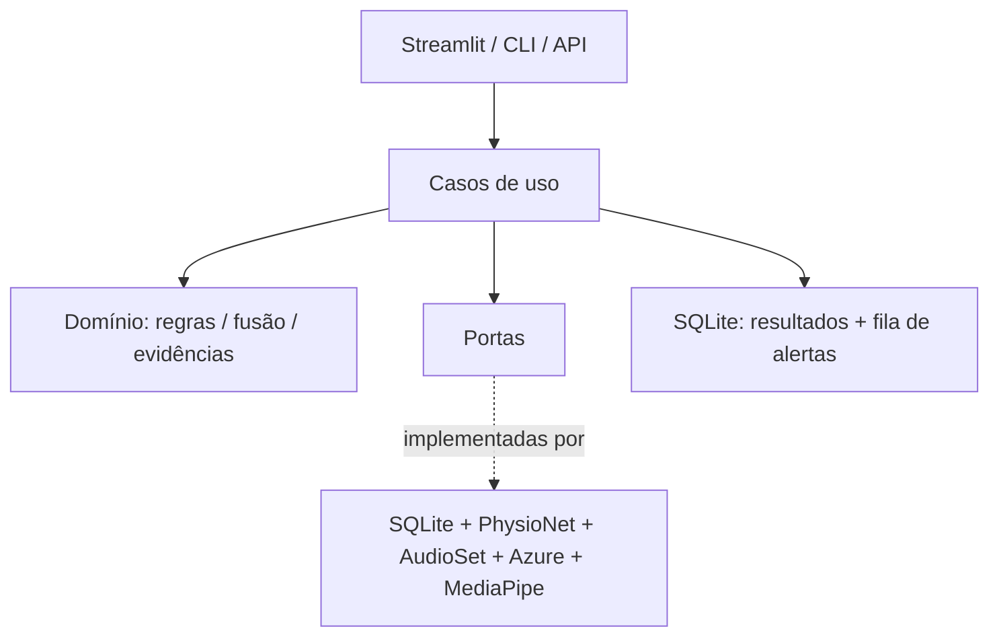

# 🩺 Tech Challenge — Fase 4 | Monitoramento multimodal

**Versão 0.9.2 — análise Azure organizada, evidências textuais e alertas vinculados à consulta.**

Protótipo acadêmico de monitoramento e alertas com **sinais vitais, prescrições,
movimentação simulada, áudio e vídeo**. Usa **PhysioNet, Google AudioSet,
Azure Speech-to-Text, Azure AI Language, MediaPipe, Python e Streamlit**.

> ⚠️ Somente para demonstração com dados públicos e casos inventados. Não é
> dispositivo médico, não diagnostica disartria/fadiga/doença e **não recebe
> telemetria hospitalar ao vivo**. Alertas são experimentais e exigem revisão humana.

## ✨ Melhorias da versão 0.9.2

- **🎙️ Áudio + Azure:** exibe a transcrição, sentimento em português, pontuações de confiança **quando fornecidas pelo Azure**, expressões-chave e entidades em tabelas legíveis (não há JSON bruto na apresentação do áudio).
- **🔎 Evidências do relato:** regras locais destacam trechos literalmente encontrados na transcrição, por exemplo **“dores nas mãos e nos punhos”** e **“têm me impedido de fazer tarefas simples”**. Esses trechos não constituem diagnóstico nem classificação clínica de gravidade.
- **🚨 Alertas vinculados:** grava, por paciente fictício, a transcrição, a análise Language e as evidências no SQLite; o alerta inclui o ID da análise de origem. A aba Alertas permite revisar os trechos ou as fontes reunidas na correlação multimodal.
- **📋 Histórico consistente:** o resultado anterior continua consultável após reiniciar o Streamlit, sem refazer chamadas ao Azure. Análises gravadas pelas versões anteriores também são apresentadas.
- **🧹 Interface simplificada:** removidas a seção de treinamento acústico experimental, as mensagens de estado interno do modelo e as antigas abas de áudio não utilizadas. O treinamento técnico permanece separado da demonstração principal. A transcrição Azure não invoca modelos sintéticos.
- **🔐 Segurança:** sem chaves no pacote; amostras de áudio e modelos locais não são distribuídos. O formato das chaves do Azure não foi alterado.
- **🧪 Testes:** casos de identificação literal, negação simples, apresentação do Azure, compatibilidade com histórico e vínculo de alertas ao registro de áudio.

**Teste recomendado:** `python -m fase4 run` → caso `TC4-P001` → aba **🎙️ Áudio + Azure** → grave uma fala encenada ou envie `0001_azure_16khz.wav` → clique **Transcrever e analisar (Azure)** → abra **🚨 Alertas**.

Para o roteiro detalhado, veja [🧪 Testes v0.9.2](docs/TEST_PLAN_v0.9.2.md).

## 🛠️ Correções da versão 0.9.1 (Windows)

- **SQLite:** `fase4.infrastructure.database.connect()` usa uma conexão que
  realiza commit/rollback e **fecha o arquivo ao sair de `with`**. Isso resolve
  os `WinError 32` nos testes que criam bancos temporários. Para usos fora de
  `with`, continua necessário fechar a conexão com `close()`.
- **Áudios WAV:** o treinamento de referências percorre os arquivos uma única
  vez e trata `.wav`/`.WAV` sem duplicar arquivos em sistemas case-insensitive.
  Com 12 arquivos de referência, o manifesto registra `reference_count=12`.
- **Regressão:** adicionados testes para fechamento do SQLite, rollback e
  extensões WAV mistas. O `.env`, o banco real e os modelos locais permanecem
  fora do pacote. Veja [🧪 Testes v0.9.1](docs/TEST_PLAN_v0.9.1.md).

## 🚀 Execute no Windows 11 / Git Bash

Atualize o projeto mantendo seus arquivos locais `.env`, `.venv`, `data/` e
`models/`. O ZIP de distribuição não inclui senhas, dados locais ou modelos.

```bash
cd /c/GITHUB/tech-challenge-fase4
source .venv/Scripts/activate
python -m pip install -e ".[all,test]"
python -m pytest -q
python -m fase4 doctor
python -m fase4 run
```

O `run` **não treina modelo próprio, não baixa áudios nem consome Azure ao iniciar**.
O banco SQLite é inicializado automaticamente, com 25 pacientes fictícios e
cenários inventados de prescrição e movimentação. **Não depende de recursos da
Fase 3.**

### 🔐 `.env` local

Seu `.env` existente continua valendo. Se precisar configurar novamente,
copie `.env.example` e preencha **somente** no seu computador:

```dotenv
AZURE_SPEECH_KEY=
AZURE_SPEECH_REGION=brazilsouth
AZURE_LANGUAGE_KEY=
AZURE_LANGUAGE_ENDPOINT=https://language-tc4.cognitiveservices.azure.com/
FASE4_DB_PATH=data/fase4.sqlite3
```

A região e o endpoint devem corresponder aos valores reais do portal.
O `.gitignore` protege o `.env`, os arquivos de pacientes, WAVs e modelos locais.
**Nunca envie as chaves nem gravações reais de consultas ao repositório.**

## 🧭 Demonstração em cinco passos (Streamlit)

1. **📦 Dados:** clicar em **Preparar amostras oficiais** e depois
   **Carregar amostra PhysioNet** no caso `TC4-P001`. É necessário acesso à
   internet nessa primeira preparação.
2. **🫀 Monitoramento:** clicar **Analisar sinais vitais, prescrições e movimentação**.
   A aba **⏯️ Replay** permite reprodução automática das horas históricas (um passo a cada três segundos), com pausa e avanço manual.
3. **🎙️ Áudio + Azure:** gravar com o microfone uma **fala encenada** de até 30
   segundos, por exemplo: *“Sinto falta de ar e dor no peito.”*. Clicar
   **Transcrever e analisar (Azure)**. Consultar transcrição, sentimento,
   frases-chave, entidades, palavras de interesse e indicadores acústicos locais.
4. **🎥 Vídeo:** preparar o modelo público MediaPipe pelo botão e enviar um MP4
   próprio/autorizado de movimento de fisioterapia. Clicar **Analisar e gerar
   relatório** e exportar JSON de ângulos e desvios.
5. **🚨 Alertas:** verificar evidências, correlação de diferentes modalidades
   no mesmo caso, e marcar alertas como revisados/descartados.

Você também pode usar **🔎 Inspecionar sinal local** sem Azure. A gravação no
navegador não dispensa a validação de formato; o formato suportado é **WAV
PCM16 mono, 16 kHz, até 30 segundos**.

### 🔬 Quais modelos/técnicas usamos?

| Requisito | Técnica | Origem | Resultado |
|---|---|---|---|
| Sinais vitais | Score robusto (mediana/MAD) e replay horário | **PhysioNet** oficial | Desvio estatístico e evidência |
| Prescrições | Comparação de dose, unidade e frequência | Cenários totalmente fictícios | Revisão de alterações |
| Movimentação em internação | Deslocamento e inatividade por trajetória | Cenário simulado | Alertas informativos |
| Consultas em áudio | **Azure Speech-to-Text** (pt-BR) | Fala própria encenada | Transcrição |
| Análise do texto | **Azure AI Language** (Text Analytics) + termos literais | Transcrição | Sentimento, frases-chave, entidades, termos |
| Padrão vocal | Energia, pausas aproximadas, clipping e ritmo estimado | Mesmo WAV | **Indícios exploratórios, não diagnóstico** |
| Vídeo clínico | **MediaPipe Pose Landmarker** + ângulos e MAD | MP4 autorizado | Relatório de desvios por articulação |
| Alertas integrados | Agrupamento por caso/modalidade e janela local de 30 min | SQLite | Fila de revisão humana |

> O **Google AudioSet** é uma das bases sugeridas no enunciado. Seus índices e rótulos
> podem ser explorados separadamente; a transcrição das consultas é realizada pelo Azure.

## 📁 Arquitetura



- `fase4/domain/`: anomalias, indicadores vocais e regras puras.
- `fase4/application/`: orquestração e portas substituíveis.
- `fase4/infrastructure/`: SQLite, Azure, WAV, MediaPipe, fontes oficiais.
- `fase4/interfaces/`: interface simplificada, API e terminal.
- `docs/`: enunciado, arquitetura, avaliação, datasets e roteiro de demonstração.

## 📚 Documentação principal

- [✅ Matriz de requisitos e estado real](docs/REQUIREMENTS.md)
- [🧭 Arquitetura e alertas](docs/ARCHITECTURE.md)
- [📦 Bases de dados e proveniência](docs/DATASETS.md)
- [🎙️ Azure Speech + Language](docs/AZURE.md)
- [🎧 Indicadores vocais e ML opcional](docs/VOICE_ANOMALIES.md)
- [🧪 Plano de testes versão 0.9.1](docs/TEST_PLAN_v0.9.1.md)
- [✅ Registro da validação local](docs/VALIDATION_v0.9.0.md)
- [📄 Relatório técnico para entrega](docs/TECHNICAL_REPORT.md)
- [🎬 Roteiro de vídeo (até 15 min)](docs/DEMO_SCRIPT.md)
- [🗂️ Histórico/fluxo experimental da versão anterior](docs/HISTORY_v0.8.5.md)

## 🧪 O que foi verificado

A suíte de testes automatizados verifica contratos, simulações, persistência,
migração SQLite, deteção estatística, fluxo Azure **com dublês de SDK**, vídeo
**com Pose simulado** e alertas multimodais. **Não significa que as chamadas
Azure reais, a detecção em MP4 real ou a acurácia clínica estejam validadas.**
Esses testes devem ser feitos no seu computador, com as chaves e arquivos de
ensaio. Os cenários são replay e eventos simulados, não monitoramento de
pacientes reais em tempo real.
