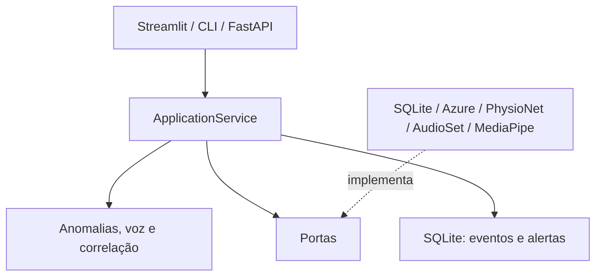
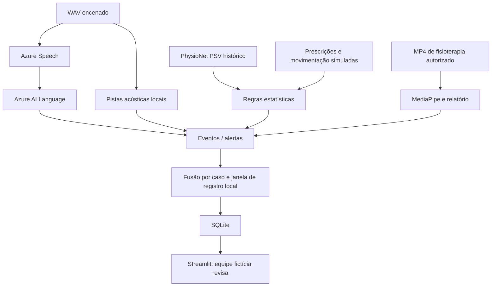
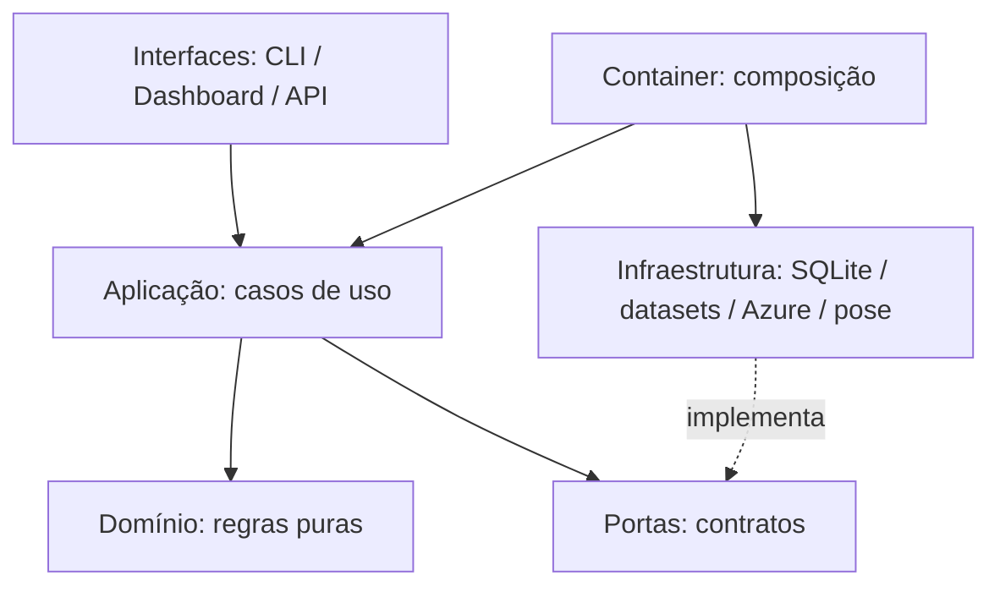
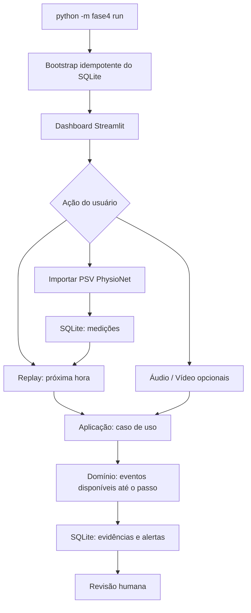
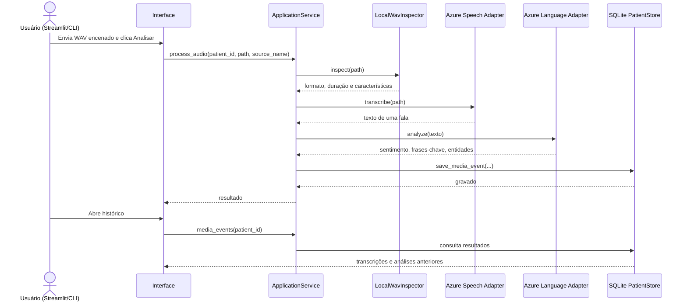

# 🧭 Arquitetura atual — v0.9.0

A versão 0.9.0 segue os requisitos obrigatórios: vídeo, Azure Speech/Language,
sinais vitais, prescrições, movimentação, fusão de alertas e revisão humana.
O isolamento em camadas permanece (domínio, aplicação, infraestrutura e interfaces).

## Pipeline demonstrativo

**Temporalidade:** eventos de PhysioNet e movimentos simulados preservam
`observed_at`; alertas armazenam `recorded_at` do momento em que foram gerados
na demonstração. A correlação utiliza `recorded_at` para mostrar o fluxo
multimodal no laboratório, **sem afirmar simultaneidade clínica real**.

**Banco:** `initialize()` adiciona `recorded_at` à tabela antiga sem apagar
alertas; novos dados de movimentação usam `movement_samples`. O vínculo com
pacientes `TC4-Pxxx` é uma associação de demonstração, não identificação da
pessoa original no PhysioNet.

**Treino próprio:** mantido como experimento via comandos legados. `run` abre
o painel sem downloads, treinamento, chamadas cloud ou geração artificial de
um modelo obrigatório. O download do modelo pré-treinado MediaPipe e as chamadas
Azure são iniciados somente por ações do usuário.

**Código antigo:** o módulo `dashboard_sections.py` mantém fluxos experimentais
para compatibilidade, enquanto `clinical_dashboard.py` implementa a interface
simplificada alinhada ao enunciado.

Veja também [REQUIREMENTS.md](REQUIREMENTS.md) e [TECHNICAL_REPORT.md](TECHNICAL_REPORT.md).

---

# Arquitetura — decisão técnica da Fase 4

## Por que não microserviços?

O desafio contém três modalidades, mas é um protótipo acadêmico a ser executado
e demonstrado por uma equipe pequena. Microserviços aumentariam deployment,
rede e observabilidade sem necessidade comprovada. Escolhemos **monólito
modular**: um projeto e uma aplicação, módulos com fronteiras verificáveis.

## Camadas e regra de dependência

- **Domínio** não importa banco, Azure, Streamlit ou MediaPipe.
- **Aplicação** conhece apenas protocolos de acesso (`PatientStore`,
  `SpeechAnalyzer`, `PoseAnalyzer`, `VoiceAnomalyModel`, `AudioSetCatalog`, `DatasetProvider`) e as
  regras do domínio.
- **Infraestrutura** concretiza esses protocolos, isolando SDKs e formatos.
- **Interfaces** chamam casos de uso, sem SQL e sem implementação de regras.
- **Container** é o único lugar que escolhe implementações concretas.
- **Catalogação dos datasets** fica atrás de uma porta de aplicação, isolando
  transferências de rede e leitura dos formatos na infraestrutura.
- **Análise de mídia:** o domínio calcula energia acústica e outliers sem
  dependências de SDK; os adaptadores leem WAV, MP4, modelo MediaPipe e Azure.

## Sequência de execução

**Quando cada parte executa**:

0. `prepare-datasets` pode ser executado no terminal ou pelo botão na aba
   **Dados**; baixa quatro arquivos oficiais limitados e grava manifesto.
1. `run` chama `bootstrap`, inicializando schema e pacientes fictícios uma vez.
2. O dashboard exibe instruções e aguarda uma ação humana. Nenhum download nem
   serviço de nuvem é chamado automaticamente ao iniciar.
3. A aba **Dados** importa a série oficial, associada apenas ao caso fictício.
4. O botão **Próxima hora** chama `replay_next`. A aplicação calcula a próxima
   hora com dados passados e persiste somente os novos eventos.
5. O botão de revisão altera o status de `pending_review` para `reviewed` ou
   `dismissed`, mantendo a evidência original.
6. `doctor` é opcional e não altera o banco nem chama Azure.
7. Na aba **Áudio**, a inspeção WAV usa só código local. A transcrição/linguagem
   chama Azure **apenas** após clique e quando existem credenciais.
8. A aba **Áudio** treina o modelo `IsolationForestVoiceModel` somente quando solicitada,
   prioritariamente com WAVs autorizados de trechos selecionados do AudioSet,
   ou em sinais sintéticos/12–100 gravações complementares para testes técnicos.
   A inferência local não chama Azure, grava features/score no SQLite e sinaliza
   problemas de qualidade separadamente do score do ML.
9. Na aba **Vídeo**, o modelo público MediaPipe é baixado **apenas** ao solicitar
   preparação; o MP4 é analisado mediante upload e outro clique.

O replay nesta versão é **manual e histórico**. O motor de eventos contínuos
com dispositivos e notificações externas ainda será desenvolvido.

## Responsabilidades

| Arquivo | Uma responsabilidade principal |
|---|---|
| `domain/anomalies.py` | Regras estatísticas / correlacionar eventos de um caso |
| `domain/replay.py` | Recortar série por origem e posição, sem antecipar horas futuras |
| `domain/voice.py` | Contrato de features, validação e interpretação do score do detector vocal |
| `infrastructure/voice_features.py` | Extrair características de WAV PCM16 mono 16 kHz |
| `infrastructure/voice_model.py` | Treino/inferência Isolation Forest, artefato e manifesto com hash |
| `domain/acoustics.py` | Energia, saturação e baixa intensidade de amostras PCM16 |
| `domain/text_flags.py` | Termos literais que exigem revisão |
| `application/ports.py` | Contratos substituíveis |
| `application/service.py` | Coordenar casos de uso e persistência |
| `infrastructure/database.py` | Esquema/consultas SQLite |
| `infrastructure/seed.py` | Criar pacientes fictícios novos |
| `infrastructure/datasets/physionet.py` | Ler e importar PSV |
| `infrastructure/datasets/audioset.py` | Ler metadados do AudioSet |
| `infrastructure/datasets/catalog.py` | Baixar fontes oficiais, criar manifesto e validar arquivos |
| `infrastructure/azure.py` | SDKs Azure Speech e Language |
| `infrastructure/pose.py` | SDK MediaPipe e cálculo de ângulos |
| `infrastructure/pose_model.py` | Obter/verificar `.task` oficial, com download limitado |
| `infrastructure/wav.py` | Ler WAV PCM16, validar duração/canais e produzir descritores |
| `infrastructure/adapters.py` | Implementações das portas |
| `interfaces/cli.py` | Comandos de operação e diagnóstico |
| `interfaces/dashboard.py` | Apresentação Streamlit |
| `interfaces/dashboard_sections.py` | Componentes de cada aba, incluindo importação e replay |
| `interfaces/api.py` | Endpoints HTTP de consulta |
| `container.py` | Montagem da aplicação |

## Decisões e limites

1. **Sem copiar a Fase 3.** Modelo de dados, identificadores e código próprios.
2. **Datasets na ordem do enunciado.** PhysioNet e AudioSet são priorizados;
   dados complementares só quando faltarem amostras adequadas.
3. **Sem treinamento de LLM como ponto de partida.** As entregas exigem análise
   multimodal e anomalias; uma LLM adicionaria custo antes de necessidade.
4. **Desvios não são diagnósticos.** Robust z-score e flags administrativos
   precisam de avaliação e revisão humana.
5. **Configuração externa, sem segredo no código.** Azure e modelo de pose são
   definidos no ambiente.
6. **Testabilidade.** Portas permitem fake de Azure/MediaPipe, isolando os
   testes do domínio de rede, GPU e credenciais.
7. **Rastreabilidade.** Cada PSV importado tem identificador derivado do
   conteúdo. O detector não compara históricos de fontes públicas distintas,
   ainda que usem o mesmo caso fictício e timestamp.
8. **Replay causal e idempotente.** Uma prévia não grava alertas; o avanço
   registra somente a hora atual, sem consultar medições futuras. A revisão
   exige identificação do caso e status pendente.
9. **Mídia com consentimento.** Apenas áudio/vídeo encenados ou explicitamente
   autorizados. Arquivos de upload são temporários; resumos e possíveis
   transcrições ficam no SQLite. Indicadores acústicos não são diagnósticos.
10. **Ativação sob demanda.** Nenhum modelo é baixado e nenhum serviço de nuvem
    é invocado ao iniciar o painel. O modelo MediaPipe não acompanha o Git.

## Próximas evoluções previstas

- Introduzir um envelope padronizado de eventos multimodais com `patient_id`,
  `timestamp`, `modality`, `severity`, `evidence` e `source`.
- Tornar o replay temporizado/automático com pausa, velocidade e indicadores
  de latência — o replay manual já está concluído.
- Integrar fusão multimodal somente entre eventos do mesmo caso demonstrativo
  e dentro de janela temporal definida.
- Coletar métricas de qualidade (precisão, recall, falsos alertas e latência).
- Validar transcrição Azure real e MediaPipe com vídeos autorizados antes do
  vídeo final; preparação do `.task` já foi validada com download oficial.

## ☁️ Sequência da etapa 0.7 — áudio Azure

O domínio **não importa SDKs Azure**; as integrações são ativadas apenas pela
aplicação. O resultado só é gravado depois de Speech e Language concluírem.
Falha de serviço retorna erro amigável sem repassar payload bruto que possa
conter dados sensíveis. O `doctor` apenas verifica presença de credenciais.
As consultas do histórico não fazem chamadas Azure.

## 🎙️ Evolução 0.8

Veja [VOICE_ANOMALIES.md](VOICE_ANOMALIES.md). O modelo vocal é opcional e não
introduz dependência do Azure na detecção acústica; o mesmo serviço de aplicação
persiste os eventos e disponibiliza o histórico no Streamlit. Treinamento e
processamento são acionados sob demanda, não ao iniciar a aplicação.

## 🔊 Extensão AudioSet (v0.8.1)

- Porta `AudioSetSamples` adicionada a `fase4/application/ports.py`.
- Implementação `LocalAudioSetSamples` em
  `fase4/infrastructure/datasets/audioset_samples.py`: seleção, verificação
  do índice, importação de WAV e proveniência.
- `ApplicationService.train_voice_audioset` orquestra extração/treinamento,
  preservando a arquitetura hexagonal.
- Split `balanced_train` e rótulo `Speech` são requisitos para treino
  acústico; split `eval` permanece reservado para avaliação futura.
- Não há download automático dos vídeos da base nem afirmação de validação
  clínica. Confira [AUDIOSET.md](AUDIOSET.md).

## 🎯 Extensão estratificada v0.8.2

O adaptador independente
`fase4/infrastructure/datasets/audioset_stratified.py` implementa seleção
reproduzível multirrótulo em `balanced_train`/`eval`, com identificação de
sobreposição, deduplicação por vídeo e manifesto de procedência local.

Os casos de uso são expostos em `ApplicationService` por
`audioset_stratified_select`, `audioset_stratified_import`,
`audioset_train_category` e `audioset_evaluate_category`. O composition root
monta o adaptador; CLI e Streamlit o consomem. Modelos de referência acústica
ficam separados por categoria, com verificação do split no treinamento.
O resultado de avaliação representa **taxa de desvios**, sem qualquer
inferência clínica.

## 🎧 v0.8.3 — Infraestrutura AudioSet

O adaptador `infrastructure/datasets/audioset_fetch.py` obtém somente mídia autorizada,
recorta trechos usando FFmpeg e delega a importação ao catálogo estratificado.
O CLI orquestra as operações e pode acionar o caso de uso existente de treino,
mantendo o domínio e o SQLite independentes de download de mídia.
Sem controle de DRM nem inferência clínica. Leia `docs/AUDIOSET_AUTOMATION.md`.

## 🔄 v0.8.5 — Orquestração na interface/CLI

A preparação simplificada fica em `fase4/interfaces/audio_setup.py`, que coordena os casos de uso existentes de datasets/treinamento e o adaptador de aquisição de fontes autorizadas. `run` executa essa coordenação antes de iniciar o Streamlit; o próprio dashboard garante o modelo local sem executar download de mídias durante uma atualização da tela. Regras acústicas permanecem nas camadas de domínio e infraestrutura. Confira [`AUDIOSET_AUTOMATICO.md`](AUDIOSET_AUTOMATICO.md).
