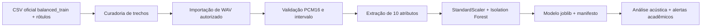

# 🔊 Google AudioSet — seleção estratificada e treinamento (v0.8.2)


## 🆕 Seleção estratificada (prioritária a partir da v0.8.2)

**Problema anterior:** a v0.8.1 selecionava os primeiros 24 segmentos `Speech`.
Essa escolha não oferecia uma amostra balanceada de sons de fala, tosse e
respiração, nem diversificação reprodutível.

**Solução atual:** `fase4/infrastructure/datasets/audioset_stratified.py`
consulta **exatamente** os CSVs oficiais `balanced_train_segments.csv`,
`eval_segments.csv` e `class_labels_indices.csv`. Resolve rótulos pelos seus
IDs oficiais (`mid`), sem assumir que um trecho tem uma única classe.

A curadoria possui cinco categorias de interesse: `Speech` (fala), `Breathing`
(respiração), `Cough` (tosse), `Wheeze` (chiado) e `Silence` (controle).
O algoritmo:

1. Define cotas de treino e avaliação por categoria (consulte README).
2. Procura primeiro os candidatos com menos rótulos simultâneos **entre essas
   categorias**, mas mantém os rótulos originais e não promete pureza acústica.
3. Ordena os demais de maneira determinística via hash SHA-256 de
   `seed | split | categoria | ID`, sem depender da ordem do CSV.
4. Seleciona no máximo um trecho de cada `youtube_id`, inclusive entre os splits.
5. Se a categoria não tiver amostras suficientes, registra `shortages` em vez
   de criar dados falsos ou inventar um ID.
6. Salva `data/raw/audioset/stratified_selection.json` com hashes dos CSVs,
   cotas, rótulos completos, intervalo, URL, split e semente.

Arquivos WAV autorizados são importados em
`data/raw/audioset/stratified_clips/<split>/<category>/<id>.wav`.
Formatos aceitos: PCM16, **mono, 16 kHz**, com duração correspondente ao
intervalo oficial (tolerância de 0,25 s). O teste de duração e os hashes
**não provam** que o WAV veio do vídeo indicado: valide visualmente a origem,
o trecho, os direitos de uso e a classe anotada antes de concluir a pesquisa.
A seleção **não** baixa os vídeos automaticamente.

### ⌨️ Comandos atuais

```bash
python -m fase4 prepare-datasets
python -m fase4 validate-datasets
python -m fase4 audioset-curate --seed 42
python -m fase4 audioset-curated-status

# Repetir para cada ID autorizado que você conseguir obter:
python -m fase4 audioset-curated-import ID_EXATO trecho.wav --confirm-rights

# Pelo menos 12 WAVs distintos em balanced_train/Cough:
python -m fase4 audioset-train-category Cough

# Opcional: importar WAVs de eval/Cough e calcular taxa de outlier:
python -m fase4 audioset-evaluate-category Cough
```

A categoria `Speech` treina o modelo principal
`models/voice_anomaly.joblib`; `Breathing`, `Cough` e `Wheeze` treinam
**modelos separados** (`models/audioset_breathing.joblib`,
`models/audioset_cough.joblib` e `models/audioset_wheeze.joblib`).
**`Silence` não é usado para treinar o Isolation Forest**, mas aparece na
seleção para estudos de controle de silêncio e inspeção. O modelo não prevê
a classe de um novo som; ao compará-lo a uma categoria você deve conhecer
antecipadamente o tipo de áudio. O painel registra a taxa de outliers no
`eval` — **isso não é acurácia nem avaliação clínica**. O corpus AudioSet é
de eventos acústicos gerais, com qualidade de rótulos variável, não um
corpus diagnóstico médico. Os 52 testes da v0.8.1 são preservados;
os testes novos usam **somente WAVs artificiais locais**, sem fingir que
são gravações do YouTube.

### 🧪 Critérios de aceitação

- A contagem por categoria bate com o manifesto e o status.
- Nenhum vídeo é reaproveitado entre treino e avaliação.
- Seleções repetidas com a mesma semente são idênticas.
- `balanced_train` é o único split aceito pelo treinamento.
- Treinamentos de `Speech` não recebem tosse/respiração, e vice-versa.
- Sem 12 WAVs de uma mesma categoria, nenhum treinamento é anunciado.
- Selecionar metadados não é equivalente a baixar ou treinar áudios.
- Resultados de `eval` são rotulados como **taxa de desvio**, jamais diagnóstico.


## 🎯 Prioridade do Tech Challenge

O enunciado **sugere explicitamente o Google AudioSet para áudio** e o PhysioNet
para séries temporais. Nesta evolução, o AudioSet é a **primeira base consultada
para processamento acústico**, enquanto o detector de disartria/fadiga continua
sem rótulos clínicos e não pode alegar validação médica.

**Página oficial:** https://research.google.com/audioset/download.html

A versão do índice utiliza os seguintes arquivos do Google:

- `balanced_train_segments.csv`: segmentos de treinamento de eventos sonoros.
- `eval_segments.csv`: conjunto separado de avaliação; **não entra no treino**.
- `class_labels_indices.csv`: nomes e IDs das classes acústicas, incluindo
  `Speech` (`/m/09x0r`).

Esses arquivos são metadados. **O AudioSet não publica um pacote WAV pronto**
para download. O Google também oferece embeddings VGGish em TFRecord, mas
eles não são equivalentes aos 10 atributos do nosso modelo vocal atual.

> ⚠️ Os direitos de cada vídeo/áudio do YouTube são distintos da licença dos
> metadados AudioSet. Importe somente segmentos que você está autorizado a
> utilizar. O aplicativo não baixa vídeos automaticamente.

## 🪟 Fluxo legado da v0.8.1 (mantido por compatibilidade)

## 🪟 Caminho no Streamlit

1. No Git Bash, ative `.venv` e execute `python -m fase4 run`.
2. Na aba **📦 Dados**, clique **Preparar amostras oficiais**.
3. Na aba **🎙️ Áudio**, procure **Google AudioSet — base prioritária oficial**.
4. Clique **Selecionar 24 trechos oficiais de fala**.
5. Abra a tabela para conferir `id`, link do YouTube e os tempos exatos.
6. Caso tenha acesso legítimo ao áudio original, recorte **o intervalo exato**,
   converta para WAV PCM16, mono, 16.000 Hz, e faça upload para o `id` escolhido.
7. Marque a confirmação de correspondência/autorização e importe o WAV.
8. Após importar no mínimo **12 arquivos distintos** do grupo `Speech`, clique
   **Treinar Isolation Forest com AudioSet (12+ WAVs)**.
9. Escolha outro WAV **fora dos exemplos usados para treinar**, faça upload na
   mesma aba e clique **Analisar WAV com modelo local**.

**Apenas selecionar os 24 registros CSV não é treinamento.** O número de WAVs
realmente importados deve aparecer no painel. A ausência de trechos de áudio
impede o treinamento oficial, mas não impede testar a demonstração sintética
ou o fluxo Azure com uma consulta encenada.

## ⌨️ Caminho pelo terminal

```bash
cd /c/GITHUB/tech-challenge-fase4
source .venv/Scripts/activate
python -m pip install -e ".[all,test]"
python -m fase4 prepare-datasets
python -m fase4 validate-datasets
python -m fase4 audioset-select --label Speech --split balanced_train --limit 24
python -m fase4 audioset-status
```

O `audioset-status` fornece IDs como `XXXXXXXXXXX_000000_010000` (o formato
representa o ID de vídeo e tempos em milissegundos). **Não invente IDs**;
utilize apenas os apresentados na sua saída do comando.

Depois de obter um trecho de áudio para uso permitido:

```bash
# Exemplo: caso você já tenha um arquivo de vídeo cujo uso está autorizado
# Use os segundos reais informados no audioset-status:
ffmpeg -ss 30 -i arquivo_autorizado.mp4 -t 10 -ac 1 -ar 16000 -c:a pcm_s16le trecho.wav

# Copie o ID exato da tabela/status e aponte para o arquivo criado:
python -m fase4 audioset-import-clip ID_EXATO trecho.wav
python -m fase4 audioset-status

# Repita a importação para pelo menos 12 IDs distintos
python -m fase4 voice-train-audioset
```

`ffmpeg` é ferramenta externa opcional, não instalada pelo projeto. A
codificação de saída precisa ser WAV PCM16 mono 16 kHz, e a duração deve
corresponder à janela do AudioSet com tolerância de 0,25 segundo.

## 🏗️ Arquitetura



| Camada | Implementação |
|---|---|
| Infraestrutura | `fase4/infrastructure/datasets/audioset_samples.py` |
| Contrato | `AudioSetSamples` em `fase4/application/ports.py` |
| Serviço | `audioset_select`, `audioset_import_clip`, `train_voice_audioset` |
| Modelo | `IsolationForestVoiceModel.train_from_audioset` |
| CLI | `audioset-select`, `audioset-status`, `audioset-import-clip`, `voice-train-audioset` |
| UI | Aba Áudio do Streamlit |

O conjunto escolhido é guardado em `data/raw/audioset/selection.json`. As
amostras ficam em `data/raw/audioset/clips/`; o modelo fica em
`models/voice_anomaly.joblib` e metadados em `models/voice_anomaly.json`.
Esses diretórios **não devem ser enviados ao GitHub**.

O manifesto registra: split, rótulo, SHA-256 do arquivo CSV, SHA-256 da
seleção e SHA-256 de cada WAV incorporado no modelo. Esses hashes asseguram a
reprodutibilidade dos arquivos locais; **não provam que um WAV fornecido é
realmente o áudio original associado ao ID YouTube**. A revisão da fonte cabe
à equipe e `source_verified` permanece `false`.

## 🧪 O que os testes automatizados comprovam?

- Consulta ao catálogo oficial por rótulo, split e identificador.
- Seleção de trechos com origem e intervalo rastreáveis.
- Bloqueio de amostras duplicadas, WAVs com duração errada e arquivos alterados.
- Isolamento entre `balanced_train` e `eval`.
- Treinamento completo em arquivos **gerados localmente nos testes**, sem
  chamar Azure, Google ou acessar conteúdo de vídeos.

**Não** comprovam desempenho estatístico com áudio real, nem diagnóstico,
capacidade de reconhecer disartria, fadiga ou falta de ar. Essas afirmações
exigiriam corpus adequadamente rotulado e validação independente.

## 🔗 Fontes

- AudioSet oficial: https://research.google.com/audioset/
- Índices e downloads: https://research.google.com/audioset/download.html
- Rótulos (ontology): https://github.com/audioset/ontology


## 🎧 v0.8.3 — Aquisição automatizada autorizada

A seleção oficial agora pode ser acompanhada por um processamento em lote de fontes autorizadas,
com recorte por intervalo, geração de WAV, rastreabilidade, retomada e treinamento após 12+ WAVs.
Veja [`AUDIOSET_AUTOMATION.md`](AUDIOSET_AUTOMATION.md) para os comandos, a exigência
de autorização de uso/download e as limitações do YouTube e das avaliações.
