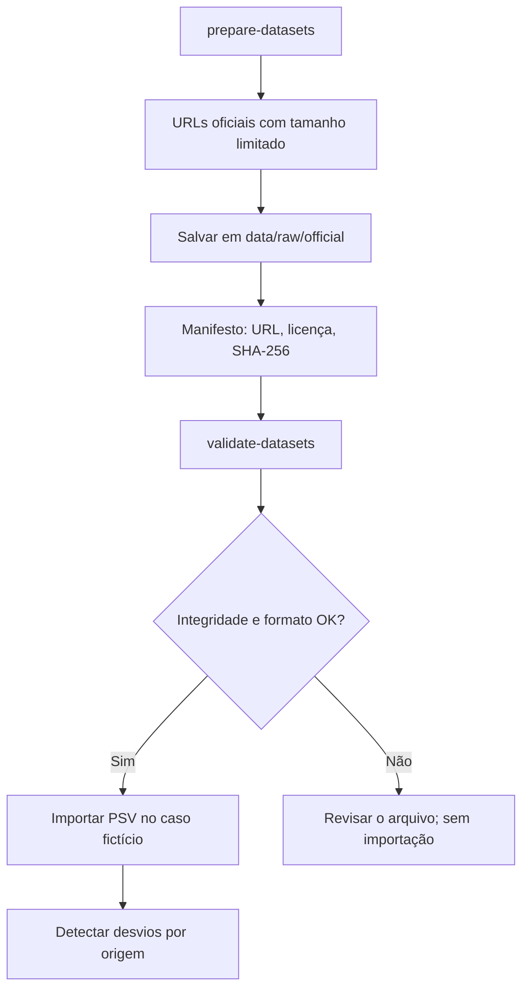

# 📦 Datasets prioritários — v0.9.0

**Ordem de preferência:** (1) enunciado FIAP, (2) complementares públicos e
adequadamente rotulados para a finalidade, (3) dados sintéticos para testes.

- **PhysioNet:** Challenge 2019, PSV público. Análise estatística de medições
  por hora e fonte. Não vincular identidade real ao paciente fictício.
- **Google AudioSet:** `balanced_train_segments.csv`, `eval_segments.csv` e
  `class_labels_indices.csv`. São **índices de eventos acústicos**, não gravações
  de consultas com transcrições nem rótulos clínicos de disartria/fadiga.
  Curadoria e modelos experimentais continuam no código, sem execução automática
  na interface padrão. Não baixar vídeos sem autorização explícita de uso e
  conforme as condições da plataforma.
- **Consultas WAV:** gravações **encenadas**, curtas, apenas para testar a
  transcrição Speech-to-Text e a análise Language; enunciado não indica dataset
  público de consultas.
- **Vídeos MP4:** cenas de fisioterapia encenadas ou autorizadas, pois o
  enunciado não prescreve dataset de vídeo concreto.
- **Prescrições/movimento:** cenários inventados no próprio banco SQLite.

Os índices AudioSet não precisam ser baixados para transcrever uma gravação
fictícia no Azure. Para detalhes experimentais antigos, veja
[AUDIOSET.md](AUDIOSET.md).

---

# 📦 Dados da Fase 4: origem, preparação e limitações

## Fontes autorizadas pelo enunciado

| Fonte | Amostra usada | O que contém | O que **não** contém |
|---|---|---|---|
| [PhysioNet Challenge 2019 v1.0.0](https://physionet.org/content/challenge-2019/1.0.0/) | `training_setB/p100679.psv` | Observações clínicas horárias, com valores ausentes | Identidade do nosso paciente fictício |
| [AudioSet](https://research.google.com/audioset/download.html) | `balanced_train_segments.csv` | Split de treino com índices de trechos de eventos sonoros | Não oferece WAVs prontos ou rótulos médicos |
| [AudioSet](https://research.google.com/audioset/download.html) | `eval_segments.csv` | IDs de vídeos, trechos e rótulos de sons | Transcrições de consulta ou áudios WAV |
| [AudioSet](https://research.google.com/audioset/download.html) | `class_labels_indices.csv` | Correspondência entre IDs e categorias acústicas | Avaliação de sintomas ou diagnóstico |

Os dados de ambas as fontes, quanto aos metadados publicamente liberados,
seguem suas licenças declaradas (incluindo CC BY 4.0). **Os vídeos e áudios
originais do YouTube podem ter direitos separados; essa licença não os libera
automaticamente.** Conserve a atribuição nos documentos e na apresentação final.

## Fluxo da etapa



Execute na raiz do projeto, após a instalação das dependências:

```bash
python -m fase4 prepare-datasets
python -m fase4 validate-datasets
python -m fase4 import-physionet data/raw/official/p100679.psv --patient TC4-P001
python -m fase4 scan vitals --patient TC4-P001
python -m fase4 audioset-preview data/raw/official/eval_segments.csv --limit 5
```

`prepare-datasets` realiza até **quatro downloads pequenos** e não baixa a base
PhysioNet completa nem vídeos do YouTube. Use `--dir OUTRA_PASTA` caso deseje
um destino distinto. Ele não substitui arquivos modificados por acidente.

`validate-datasets` não utiliza rede e verifica:

- presença dos arquivos e metadados de atribuição;
- SHA-256 consistente com o manifesto;
- existência de colunas, linhas e valores esperados no PSV;
- consistência dos IDs e nomes de classes do AudioSet;
- quantidade de registros e trechos com rótulos ligados a fala.

## Separação entre dados públicos e fictícios

1. A base de **25 pacientes** é inteiramente nova e fictícia, criada no SQLite
   da Fase 4.
2. O PSV oficial representa uma série histórica pública de outra pessoa e é
   associado a um identificador fictício **exclusivamente para demonstração**.
3. Cada PSV recebe uma identificação de origem baseada no hash do conteúdo.
   Reimportar o mesmo arquivo não duplica medições; arquivos distintos não
   compartilham histórico de referência na detecção de anomalias.
4. Áudios encenados, vídeos e séries PhysioNet são fontes independentes;
   correlação temporal ou causal entre pessoas reais não pode ser inferida.
5. O projeto **não reutiliza código, dados ou banco da Fase 3**.

## 🎙️ Curadoria real do AudioSet na versão 0.8.1

O projeto utiliza os CSVs oficiais para escolher trechos `Speech` de
`balanced_train`, exibe origem/intervalo, aceita um WAV correspondente por
registro e permite treinar a referência acústica com pelo menos 12 trechos
importados. Os arquivos WAV não vêm no pacote; sua obtenção depende de
permissão de uso do conteúdo audiovisual e disponibilidade dos vídeos. O
`eval_segments.csv` permanece separado, para impedir o uso acidental de
amostras de avaliação no treinamento. Consulte
[AUDIOSET.md](AUDIOSET.md) para instruções de importação e validação.

## Por que não usar o AudioSet como conversa médica?

O AudioSet foi feito para reconhecer classes de **eventos sonoros**; muitos
rótulos referem-se a fala, mas as anotações não são uma transcrição de diálogo
clínico, nem indicam disartria. Para a demonstração de transcrição, usaremos
um WAV curto **encenado e consentido**, analisado pelo Azure Speech/Language.
Nenhum classificador de sentimento pode, isoladamente, diagnosticar doenças.

## Fora do escopo desta etapa

- Downloads dos arquivos completos de treinamento e features de 2,4 GB.
- Extração automática de áudio a partir de vídeos hospedados no YouTube
  (o usuário pode importar trechos WAV que obteve legalmente).
- Processamento em streaming / dispositivos hospitalares.
- Autenticidade de uma consulta real ou atribuição de dados a paciente real.
- Avaliação de métricas clínicas; alertas são experimentais.


## 🔊 Política de curadoria AudioSet — v0.8.2

Prioridade à base **Google AudioSet**, sugerida no enunciado. Para análise
acústica, selecionamos `Speech`, `Breathing`, `Cough`, `Wheeze` e `Silence`.
A seleção por categoria é determinística e não repete `youtube_id` entre
`balanced_train` e `eval`. A classe atribuída é organizacional; o AudioSet é
multirrótulo e uma amostra pode conter sons sobrepostos. Modelos acústicos
por categoria são separados; o `Silence` é utilizado como controle.
Dados artificiais permanecem somente em testes/demonstrações técnicas.
Não há rótulos de disartria/fadiga, nem avaliação clínica automática.

Consulte [AUDIOSET.md](AUDIOSET.md) e [TEST_PLAN_v0.8.2.md](TEST_PLAN_v0.8.2.md).


## 🎧 v0.8.3 — Aquisição automatizada autorizada

A seleção oficial agora pode ser acompanhada por um processamento em lote de fontes autorizadas,
com recorte por intervalo, geração de WAV, rastreabilidade, retomada e treinamento após 12+ WAVs.
Veja [`AUDIOSET_AUTOMATION.md`](AUDIOSET_AUTOMATION.md) para os comandos, a exigência
de autorização de uso/download e as limitações do YouTube e das avaliações.


## 🗃️ Nota sobre o fluxo antigo da versão 0.8.5

A descrição histórica de preparação automática em [`AUDIOSET_AUTOMATICO.md`](AUDIOSET_AUTOMATICO.md) **não corresponde ao comportamento atual da versão 0.9.2**. Atualmente, `python -m fase4 run` somente prepara o banco fictício e inicia o Streamlit: **não baixa datasets, não executa curadoria e não treina modelo de voz automaticamente**. Para dados oficiais, execute `prepare-datasets`, `validate-datasets` e `import-physionet` explicitamente. Para vídeo, execute `prepare-pose-model`. Veja [`SETUP_WINDOWS.md`](SETUP_WINDOWS.md).
