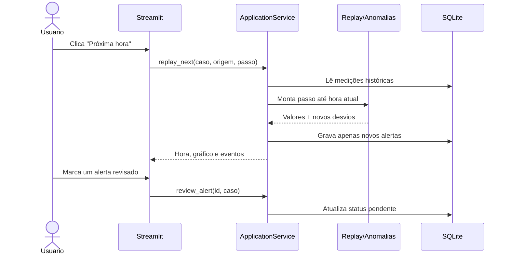

# ⏯️ Replay temporal — etapa 0.4

## Objetivo

Construir uma demonstração **visível e gradual** de monitoramento dos sinais
vitais com arquivos oficiais do desafio, sem precisar de equipamento hospitalar
ou serviços pagos para o primeiro cenário. Isto não é telemetria em tempo real.

O fluxo é acionado pelo usuário, **um passo por clique**. Cada passo avança
para a próxima hora registrada na série pública escolhida.

## Como usar no Git Bash (Windows)

Depois de atualizar os arquivos do projeto, na sua pasta de trabalho:

```bash
cd /c/GITHUB/tech-challenge-fase4
source .venv/Scripts/activate
python -m fase4 run
```

Não precisa recriar o ambiente ou o banco se já estiverem funcionando.
Na primeira utilização, vá à aba **📦 1. Dados**:

1. Clique em **Preparar amostras oficiais**. Se já executou
   `python -m fase4 prepare-datasets`, não é necessário clicar novamente.
2. Clique em **Carregar amostra PhysioNet neste caso** para associar o registro
   à identidade fictícia `TC4-P001`.
3. Abra **⏯️ 2. Replay temporal** e clique em **Reproduzir próxima hora**.
4. Acompanhe a posição, os valores e o gráfico que cresce. Quando aparecerem
   desvios, abra **🚨 5. Alertas**, examine as evidências e marque a decisão.

Se quiser usar outro arquivo do PhysioNet, abra **Ou importar outro arquivo
PSV oficial**. O sistema conserva identificações de origem independentes.

## Ordem exata de processamento



## O que cada camada faz

| Camada | Responsabilidade |
|---|---|
| `domain/replay.py` | Seleciona somente as medições já ocorridas no passo, separa fontes e identifica eventos novos |
| `domain/anomalies.py` | Calcula desvios robustos sem thresholds clínicos |
| `application/service.py` | Coordena avanço e persistência, expõe prévia sem gravação |
| `application/ports.py` | Define contrato para registrar revisão humana |
| `infrastructure/database.py` | Guarda medições, evidências e status dos alertas |
| `interfaces/dashboard.py` | Cria abas e seleciona o caso fictício |
| `interfaces/dashboard_sections.py` | Exibe botões, gráficos, instruções e evidências |

### Dois métodos importantes

- `replay_preview(...)`: consulta um passo **sem gravar alertas**. Usado para
  desenhar a interface a cada atualização.
- `replay_next(...)`: avança apenas um passo e salva os alertas **daquela
  hora**. Repetir o mesmo passo não duplica os mesmos eventos.

## Sem antecipação de dados

Se o histórico tiver 18 horários disponíveis, a posição 5 utiliza só os cinco
primeiros horários. Um valor da hora 6 **não pode** mudar o resultado da hora
5. Isso evita que o exemplo use inadvertidamente informações futuras.

## Persistência e revisão

- Os alertas são guardados no SQLite com `pending_review` inicialmente.
- Uma revisão muda o status para `reviewed` ou `dismissed`.
- Não é possível revisar um evento de outro caso fictício nem revisar de novo
  um evento que já recebeu decisão.
- **Voltar ao início do replay** reinicia apenas a posição na interface.
  Não remove medições, alertas ou decisões anteriores.

## Limitações transparentes

- O tempo mostrado é um relógio de replay rebaseado para **01/01/2026 UTC**,
  criado pelo importador. Não é a data real de atendimento do registro.
- A identidade `TC4-P001` é fictícia e não corresponde ao paciente PhysioNet.
- AudioSet contém rótulos de sons, não transcrições clínicas. Áudio e vídeo
  permanecem demonstrações separadas até validação das integrações.
- Eventos estatísticos não equivalem a diagnóstico ou risco clínico validado.
- A reprodução é manual nesta versão, sem captura ao vivo nem notificações
  externas para equipe de saúde.

## Testes e próxima etapa

```bash
python -m unittest discover -s tests -v
```

Os testes cobrem avanço incremental, ausência de dados futuros, isolamento
entre fontes, deduplicação e transição de status de alertas.

Próximas etapas: integrar áudio/vídeo reais com credenciais e modelos
configurados; depois tratar fusão multimodal de eventos apenas em um cenário
demonstrativo coerente e rotulado.
