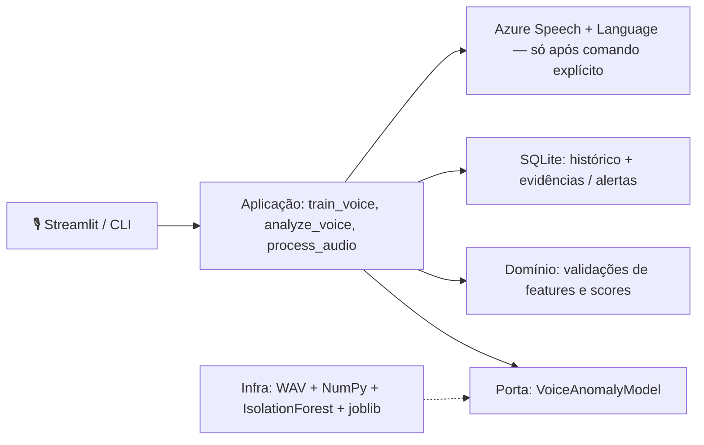

# 🎙️ Análise de fala — requisito e experimento opcional

## Funcionalidade principal (v0.9.0)

- **Azure Speech-to-Text:** transcreve uma fala fictícia curta em pt-BR.
- **Azure AI Language:** sentimento textual, frases-chave e entidades.
- **Termos literais:** alerta de revisão para expressões como *falta de ar*.
- **Características acústicas locais:** fração de baixa energia, saturação e
  ritmo aproximado (quando possível), sem transformar isso em diagnóstico.

Apenas esses indicadores simples **não identificam clinicamente fadiga,
disartria ou distúrbios respiratórios**. A identificação clínica validada dessas
condições permanece fora do alcance desta demonstração.

## Isolation Forest (opcional)

O treinamento adicional usado nas versões 0.8.x **não é requisito expresso da
FIAP**. Sua execução continua possível via comandos avançados e AudioSet, mas
não ocorre ao chamar `python -m fase4 run`. Um modelo `synthetic_demo` gerado
em versões anteriores pode continuar no computador, identificado como
experimento, não como análise clínica. O AudioSet não oferece rótulos médicos.

Consulte [REQUIREMENTS.md](REQUIREMENTS.md),
[AUDIOSET.md](AUDIOSET.md) e o [histórico 0.8.5](HISTORY_v0.8.5.md).

---

> **Atualização v0.8.2:** A referência sintética é apenas demonstração.
> A nova curadoria prioriza `Speech`, `Breathing`, `Cough`, `Wheeze` e `Silence`
> do AudioSet oficial, reservando `eval` para teste independente. **Cada
> categoria treinável possui um modelo de desvio próprio; não se misturam os
> sons em um único modelo.** `Silence` é controle sem treinamento. Consulte
> [AUDIOSET.md](AUDIOSET.md). Não há rótulos de patologias clínicas.

# 🎙️ Versões 0.8/0.8.1 — Modelo local de anomalias acústicas

## 🎯 Por que essa etapa existe?

O enunciado da Fase 4 solicita detecção de alterações vocais em consultas. O
Azure Speech **transcreve** e o Azure Language **analisa textos**; nenhum deles,
nesse fluxo, classifica fadiga, disartria ou dificuldade respiratória diretamente
pelo sinal acústico. Por isso adicionamos um experimento de detecção de **desvios
estatísticos** em WAVs, **sem diagnosticar doenças**.

## 🏗️ Arquitetura mantida



- **`fase4/domain/voice.py`**: nomes/ordem dos atributos, validação e interpretação matemática do score.
- **`fase4/infrastructure/voice_features.py`**: leitura PCM16 mono 16 kHz (0,5–30 s) e extração numérica.
- **`fase4/infrastructure/voice_model.py`**: treinamento, inferência, manifesto e artefato `joblib`.
- **`fase4/application/ports.py`**: contrato `VoiceAnomalyModel`.
- **`fase4/application/service.py`**: orquestra treinamento, análise, persistência e alertas.
- **`fase4/interfaces/dashboard_sections.py`**: botões e visualizações, sem ML dentro da interface.

## 🔎 Características extraídas

| Característica | Interpretação técnica | Limitação |
|---|---|---|
| `rms_dbfs` | Energia média relativa ao limite de digitalização | Depende do microfone/distância |
| `low_energy_fraction` | Porção de janelas com baixa energia | Não identifica clinicamente pausas respiratórias |
| `clipped_fraction` | Amostras próximas à saturação digital | Pode indicar defeito de gravação |
| `rms_variability_db` | Variação de energia nas janelas ativas | Influenciada por ambiente e locutor |
| `zero_crossing_rate` | Alternâncias de sinal por amostra | Sensível a ruído |
| `spectral_centroid_hz` | Centro de massa do espectro | Não diagnostica alterações na voz |
| `spectral_flatness` | Medida de espectro tonal versus difuso | Mudanças dependem do ambiente |
| `pitch_median_hz` | Estimativa aproximada da frequência fundamental | Pode falhar em fala, ruído e silêncio |
| `pitch_variability_hz` | Variação estimada do pitch | Não mede fadiga por si só |
| `voiced_fraction` | Proporção de janelas com periodicidade detectável | Não equivale à proporção de fala humana |

O leitor tem limite de 16 MiB. A extração é determinística para o mesmo WAV.

## 🧠 Modelo e decisão

- `StandardScaler` seguido de `IsolationForest`, 120 árvores, `random_state=42`, `contamination=0.10`.
- Treino prioritário com **12–100 WAVs selecionados pelo índice oficial AudioSet**
  (`balanced_train_segments.csv`, rótulo `Speech`), modo `audioset_speech_reference`,
  desde que os áudios correspondentes estejam disponíveis legalmente e tenham sido importados.
- Treino auxiliar com **48 sinais sintéticos** no modo `synthetic_demo` **ou** com
  **12–100 WAVs autorizados** no modo `reference_wav` (bases complementares),
  apenas para testes técnicos quando não houver exemplos AudioSet adequados.
- `decision_function < 0` => `ml_prediction = outlier`; `>= 0` => `inlier`.
- Há **avisos de qualidade independentes do ML**: `CLIPPING` quando pelo menos 1% das amostras estão saturadas; `LOW_ENERGY` quando pelo menos 35% do sinal tem baixa energia.
- `prediction` reúne o alerta ML **ou** os indicadores de qualidade, e o retorno **sempre** mostra `ml_prediction` e `quality_flags` separados. Portanto, `prediction=outlier` pode significar **apenas defeito de gravação**, não anomalia vocal médica.
- Os indicadores são salvos no SQLite como `media_events` de áudio; um resultado `outlier` gera alerta `VOICE_ACOUSTIC_OUTLIER` de severidade `info`, sujeito a revisão humana, e **não** a acionamento de emergência.

### ⚠️ Sobre os dados e a validação

O **Google AudioSet** é a base prioritária. Na versão 0.8.1, o modelo pode
ser treinado com **WAVs autorizados correspondentes a trechos do split oficial
`balanced_train` rotulados `Speech`**, por meio de um catálogo local rastreável.
A seleção dos índices é automática, mas os WAVs não são distribuídos pelo Google
no mesmo formato e precisam ser providenciados. O programa verifica o cadastro,
intervalo e hashes, **não** verifica a autenticidade da fala frente ao vídeo do
YouTube. Esses rótulos descrevem eventos acústicos, **não** disartria ou sintomas.
**Não afirmamos que o treino com AudioSet foi executado em dados reais** até
que os trechos de áudio autorizados tenham sido importados no ambiente local.
Veja [AUDIOSET.md](AUDIOSET.md). **Não declaramos acurácia clínica, sensibilidade, especificidade ou validação de fadiga/disartria**.

Sinais da demonstração (`sinal_sintetico_referencia.wav` e `sinal_sintetico_alterado.wav`) são **ondas geradas por código**, não contêm fala. A classificação `outlier` no sinal alterado pode decorrer do indicador determinístico de saturação, mesmo quando o Isolation Forest retorna `inlier`; isso é propositalmente transparente.

Para treinar com gravações complementares, use somente dados próprios encenados, adequadamente autorizados e provenientes de condições semelhantes, **sempre separados do WAV a ser pontuado**. O modelo pode se confundir com diferenças de microfone, idioma, ambiente e locutor. Um corpus rotulado, protocolo de avaliação e validação por especialistas seriam necessários para qualquer aplicação real.

## 🪟 Testar agora no Git Bash

```bash
cd /c/GITHUB/tech-challenge-fase4
source .venv/Scripts/activate
python -m pip install -e ".[all,test]"
python -m fase4 doctor

# Opção A: tudo pelo Streamlit
python -m fase4 run
```

Na aba **🎙️ 3. Áudio**, clique **🧪 Treinar referência sintética (demo)** e depois **🔊 Gerar 2 WAVs sintéticos para testar**. Faça download dos dois arquivos, anexe um de cada vez ao upload da aba e clique **🧠 Analisar WAV com modelo local (sem Azure)**. O histórico pode ser visto ao final da seção.

Comandos equivalentes (sem interface/sem Azure):

```bash
python -m fase4 voice-train-demo
python -m fase4 voice-demo-files
python -m fase4 init
python -m fase4 voice-analyze data/demo/voice/sinal_sintetico_referencia.wav --patient TC4-P001
python -m fase4 voice-analyze data/demo/voice/sinal_sintetico_alterado.wav --patient TC4-P001
python -m fase4 alerts --patient TC4-P001
```

Para usar a referência própria, crie um diretório com **no mínimo 12** arquivos WAV diferentes, com os mesmos parâmetros técnicos (16 kHz, mono, PCM16, 0,5–30 s):

```bash
python -m fase4 voice-train-references data/raw/voice_references
```

⚠️ Esse comando **substitui o modelo local anterior**. O projeto mantém somente um baseline ativo por vez. A amostra a ser avaliada **não pode** fazer parte da referência de treinamento.

## ☁️ Integração com Azure (opcional)

Após treinar o modelo e configurar as variáveis do `.env`, envie um **WAV com uma pessoa falando de verdade** e clique **☁️ Transcrever e analisar com Azure**. O mesmo fluxo passa também pelo detector vocal e salva o relatório composto, mas **não envia as features do detector à nuvem**. Os sinais artificiais da demo **não devem** ser enviados ao Azure porque não contêm fala.

A transcrição curta permanece limitada ao modo *recognize_once*. Os alertas de fala/termos são acadêmicos; a associação à identidade do paciente é demonstrativa.

## 🗄️ Artefatos e proteção

- `models/voice_anomaly.joblib` — modelo local treinado.
- `models/voice_anomaly.json` — manifesto: versão, modo, quantidade de amostras, ordem de features, data e checksum SHA-256.
- `data/demo/voice/*.wav` — sinais de teste gerados.
- `data/raw/voice_references/*.wav` — referências locais opcionais.

Os diretórios são ignorados pelo Git. **Não execute `joblib.load` em um modelo recebido de fontes desconhecidas**: arquivos pickle/joblib podem executar código ao carregar. Não inclua os WAVs e chaves Azure em commits, ZIPs de entrega ou capturas sensíveis.

## 🧪 Testes e limitações

```bash
python -m pytest -q
# ou:
python -m unittest discover -s tests -v
```

Os testes usam sinais gerados e Azure simulado. **Não comprovam qualidade médica, nem execução real no Azure**; essa validação deve ser feita na máquina Windows com o `.env` privado.


## 🎧 v0.8.3 — Aquisição automatizada autorizada

A seleção oficial agora pode ser acompanhada por um processamento em lote de fontes autorizadas,
com recorte por intervalo, geração de WAV, rastreabilidade, retomada e treinamento após 12+ WAVs.
Veja [`AUDIOSET_AUTOMATION.md`](AUDIOSET_AUTOMATION.md) para os comandos, a exigência
de autorização de uso/download e as limitações do YouTube e das avaliações.


## ✅ v0.8.5 — Modelo disponível ao abrir a interface

O `run` prepara um modelo automaticamente e dois sinais de teste em `data/demo/voice/`. Quando existem ao menos 12 WAVs válidos importados de `Speech`/`balanced_train`, o modelo é treinado com as referências oficiais. Caso contrário, o modelo **`synthetic_demo`** é usado exclusivamente para demonstrar o funcionamento do pipeline e não deve ser relatado como treino AudioSet nem como reconhecimento de fadiga ou disartria. A interface oferece teste direto com um sinal artificial e gravação por microfone para análise experimental. Veja [`AUDIOSET_AUTOMATICO.md`](AUDIOSET_AUTOMATICO.md).
